# Star History

Star history charts for any public GitHub repo, as an SVG you can paste into a README. Exact weekly data, eight looks, no JavaScript on the page that shows it.

**[starhistory.link](https://starhistory.link)**

<p align="center">
  
</p>

## Add a chart to your README

Open the site, enter `owner/repo`, pick a look, copy the line. Or write it yourself:

```md
[](https://starhistory.link/OWNER/REPO)
```

The animation is plain CSS inside the SVG, so it plays in a GitHub README, where scripts don't run.

## Looks

| | |
| --- | --- |
| <br>`space`: a rocket rides the curve | <br>`synthwave`: neon grid, 80s sunset |
| <br>`matrix`: follow the white rabbit | <br>`default`: clean and dark |

Also `light`, `minimal` and `glass`.

## Options

Add them to the image URL as query parameters.

| Parameter | Values | Default |
| --- | --- | --- |
| `style` | `default`, `light`, `minimal`, `glass`, `ascii`, `matrix`, `space`, `synthwave` | `default` |
| `theme` | `mono`, `cyan`, `emerald`, `violet`, `amber`, `rose`, `fuchsia`, `blue`, `lime` | `mono` |

`matrix`, `space` and `synthwave` bring their own palette and ignore `theme`.

## Where the numbers come from

GitHub restricted its stargazers listing to repo admins in 2026, which broke most star history tools. This one uses GitHub's repository star history endpoint instead (`GET /repos/{owner}/{repo}/stargazers/history`), which returns exact stars per week for any public repo. The weekly totals add up to the live star count.

## Run it locally

```sh
npm install
cp .env.example .env   # optional: a GITHUB_TOKEN raises the API rate limit
npm run dev
```

SvelteKit 2 and Svelte 5. Each chart is a Svelte component that the `/owner/repo.svg` route renders on the server with `render()` from `svelte/server`. Social images (`/og/owner/repo.png`) are drawn with resvg.

## Contributing

Issues and pull requests are welcome. If you add a look, put it in `src/lib/components/StarGraphSVG.svelte` and add a preview to `docs/previews`.

If this saved you time, a star helps other people find it.
